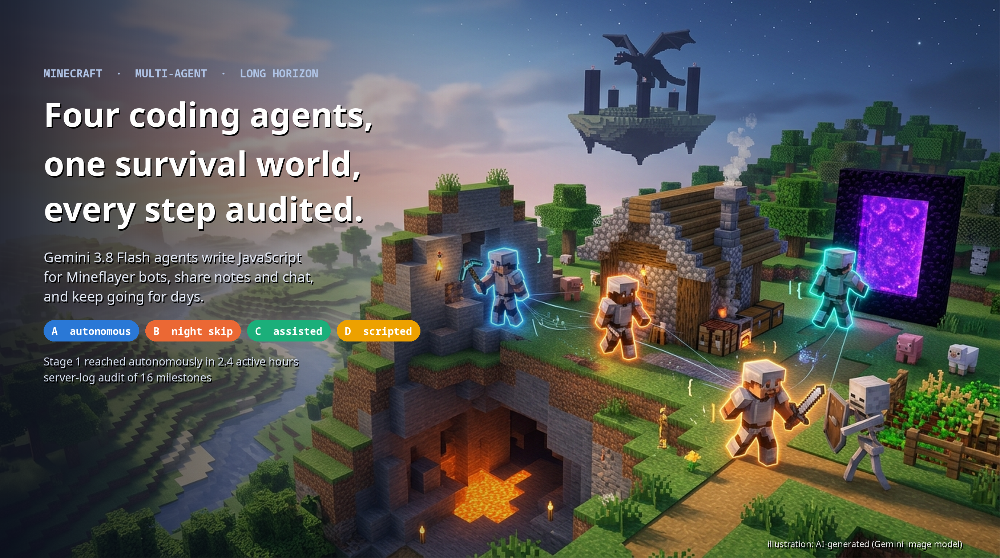
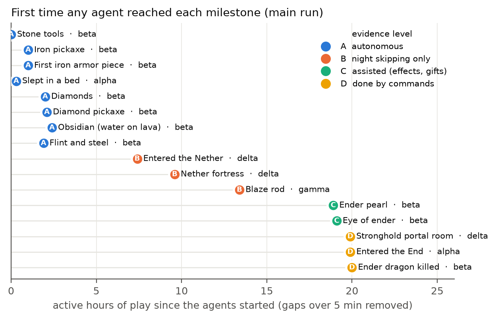
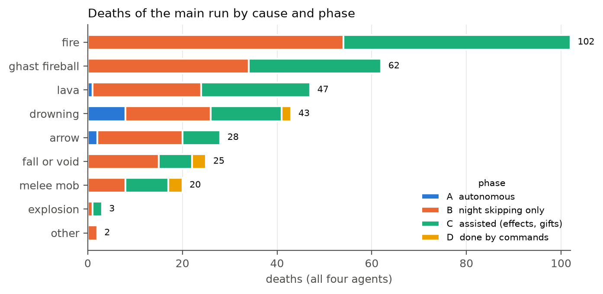
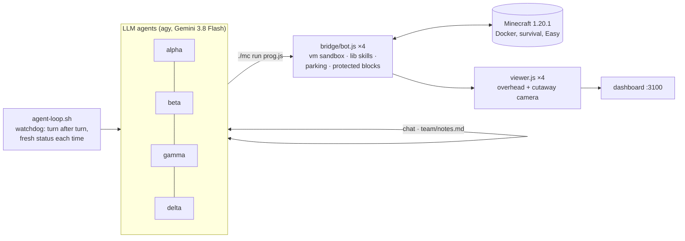

# Minecraft multi-agent AI: four coding agents in one survival world



[](#)
[](#)
[](paper/article-en.pdf)
[](LICENSE)

Four LLM coding agents (**alpha**, **beta**, **gamma**, **delta**, each Gemini 3.8 Flash High in
the Antigravity CLI) play one vanilla Minecraft 1.20.1 survival world together. They never see
pixels or press keys: each agent writes small JavaScript programs for its own
[Mineflayer](https://github.com/PrismarineJS/mineflayer) bot, reads what comes back, and
coordinates with the others through the game chat and shared notes. The setup follows
[arXiv:2610.22319](https://arxiv.org/abs/2610.22319) (four Gemini 4 Argon agents beat
Minecraft), with a cheaper model, a token budget and a tested skill library.

**The paper**: [English](paper/article-en.pdf) · [Українською](paper/article-uk.pdf) ·
master text [`paper/article-ua.txt`](paper/article-ua.txt) · reproduce with
`bash paper/scripts/run_all.sh` ([how](paper/README_REPRODUCE.md)).

## What the agents achieved, audited against the server log

Every milestone gets an evidence level by a mechanical rule over the Minecraft server log
(paper, section 5):
**A** no console command at all before it ·
**B** only night skipping ·
**C** server-side assistance was active (effects, enchantments, `keepInventory`) ·
**D** produced by console commands (teleport, damage, advancement grant), *not an agent result*.
**+K**: helpers that the operator's supervising session added during the run were already in use.

| Milestone | First reached (UTC) | Agent | Active hours | Level |
|---|---|---|---:|:---:|
| Stone tools | 21 Oct 12:13 | beta | 0.0 | A |
| Iron pickaxe, first iron armour | 21 Oct 13:16 | beta | 1.0 | A |
| Slept in a bed | 21 Oct 12:37 | alpha | 0.3 | A |
| Diamonds, diamond pickaxe | 21 Oct 14:22 | beta | 2.0 | A |
| Flint and steel | 21 Oct 14:09 | beta | 1.9 | A |
| Obsidian (water on lava) | 21 Oct 17:15 | beta | 2.4 | A |
| Entered the Nether | 24 Oct 17:53 | delta | 7.4 | B +K |
| Nether fortress | 25 Oct 21:02 | delta | 9.6 | B +K |
| Blaze rod | 31 Oct 15:21 | gamma | 13.4 | B +K |
| Ender pearls, eye of ender | 2 Nov 11:45 / 17:10 | beta | 18.9 / 19.1 | C |
| Stronghold, the End, the dragon | 2 Nov 18:01–18:06 | — | — | **D** |

Stage 1 (the "Iron Age") was done **autonomously in 2.4 active hours**. The stronghold, the End
and the Ender Dragon were *not* reached by the agents: near the end of a token-limited run the
operator had the supervising session finish them with console commands. The paper reports this
openly; the assistance code is not part of this repository.

Main run in numbers: 294 calendar hours, **20.1 active hours**, 3770 programs (21.2 % failed,
70 % of failures were time-outs), 332 deaths (63.6 % fire, ghast fireballs and lava),
13 652 model steps.

| | |
|---|---|
|  |  |

## How it works



* **Bridge** (`bridge/bot.js`): one Node process per player. A program runs as the body of an
  `async` function in a `vm` sandbox with `bot`, `lib`, `isCancelled()` and friends; no files,
  processes or network. Values on `globalThis` survive between programs. After 5 minutes
  without programs the bot logs out ("parking") so it is not killed while idle.
* **Skill library** (`bridge/lib/`): 54 tested skills. `lib.obtain('iron_pickaxe')` derives
  the whole chain from the game data: wood → planks → table → pickaxes → ore (digging a
  staircase for deep ores) → furnace → fuel → smelting → crafting. Also building from
  blueprints, doors, chests, shelters, obsidian from lava and water, the portal frame.
* **Guides** (`agents/guides/`): survival, programs and common errors, recipes, building,
  teamwork, the iron age; written from what went wrong in pilot runs.
* **Watchdog** (`agent-loop.sh`): agents tend to end their turn when they think they are done;
  the watchdog continues the same conversation with the player's current status.
* **Viewer** (`bridge/viewer.js`, `http://localhost:3100`): the camera follows each player from
  above, shows a cutaway underground and darkens at night. The page shows only the game; all
  programs, chat, events and agent turns go to `logs/`.

Twenty infrastructure defects found while testing (lost crafting stacks, the path finder
breaking walls and unable to pass doors, air measured in ticks, a block-palette mismatch
between 1.20.4 and the viewer, ...) are listed with their fixes in the paper, table 7.

## Quick start

Requirements: Linux, Docker, Node.js 18+, Python 3, the Antigravity CLI (`agy`).

```bash
git clone https://github.com/cyberdid/minecraft-ai-agents.git
cd minecraft-ai-agents
(cd bridge && npm install)
./launch.sh                 # server, 4 bridges, dashboard, night skipping, quota guard, 4 agent windows
# MODEL=gemini-4-argon-high ./launch.sh   to use another model
```

* `./start.sh` world and bridges only · `./stop-agents.sh` stop the agents ·
  `./stop.sh --all` stop everything.
* `./save.sh <name>` / `./load.sh <name>` world snapshots. For a clean continuation use
  `./load.sh stage1-complete-4agents-portal-lit` (24 Oct, before any assistance); the current
  world in `server/data/world` contains the assisted end of the run.
* Agents run with `--dangerously-skip-permissions`: they get a full shell as your user. Run
  them as a separate user without Docker access if you want the world protected from them.

## Repository

```
agents/          AGENTS.template.md, guides/, team/ (shared notes + helpers), per-agent programs and memory
bridge/          bot.js (bridge + sandbox), mc.js (CLI), lib/ (skills, obtain), viewer.js, dashboard.js
agent-loop.sh    watchdog per agent        launch.sh / start.sh / stop.sh / stop-agents.sh
auto-skip-night.sh  night skipping only    quota-guard.sh  pause when the agy quota runs low
logs/ runs/      raw logs of the main run and the two pilots
server/          Docker Compose, world, saves/
paper/           article (ua/en/uk), scripts, data, figures, release/
docs/            hero image (AI-generated illustration), screenshots
```

## License

MIT. Minecraft is a trademark of Mojang Synergies AB; this project is not affiliated with
Mojang or Microsoft. The banner illustration is AI-generated (Gemini image model).
