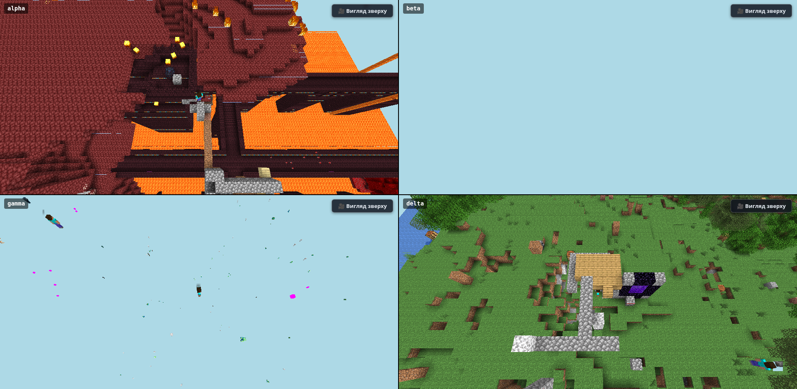
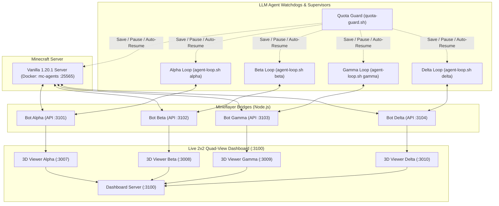

# Minecraft Autonomous Multi-Agent AI (Alpha, Beta, Gamma & Delta) 🤖⛏️🔥

[](https://www.minecraft.net/)
[](#)
[](https://nodejs.org/)
[](https://www.docker.com/)
[](LICENSE)

An open-source framework for **fully autonomous, cooperative 4-agent AI** in vanilla Minecraft 1.20.1 survival mode. Four autonomous agents (**Alpha**, **Beta**, **Gamma**, and **Delta**) collaborate in real time without human intervention: gathering resources, crafting tools and full iron armor, building shelters and blast-proof Nether tunnels, managing hunger and inventory, mining diamonds & obsidian, lighting a Nether portal, and assaulting a Nether Fortress Blaze Spawner on their way to defeating the Ender Dragon.



---

## 🌟 Key Features

* **4-Agent Cooperative Squad (`Alpha`, `Beta`, `Gamma`, `Delta`):**
  * **Emergent Role Specialization:** Parallel division of labor across Overworld logistics, deep-slate diamond/obsidian mining, Nether ridge scouting, blast-proof tunnel engineering, and Blaze Spawner fortification.
  * **Shared Base & Chest Logistics:** Agents exchange resources, iron, food, cobble, and recovery gear through shared base storage and furnaces.
  * **Inter-Agent Chat & Shared Memory:** Agents coordinate waypoints, hazards, and tasks in real time via in-game chat and shared team notes (`agents/team/notes.md`) plus shared JS helpers (`agents/team/autoload.js`).
* **Autonomous Survival & Engineering Skills (`bridge/lib.js` + `autoload.js`):**
  * Automated prerequisite resolution (`lib.obtain`) for crafting wooden/stone/iron/diamond tools, shields, and full iron armor sets.
  * Multi-furnace smelting and automated fuel management.
  * Hazard-aware pathfinding (`configureFireAvoidance`) avoiding fire, soul fire, lava lakes, and steep abyss drops.
  * Cave-safe obsidian casting (`makeObsidianSafe`) supporting 1.20 `cave_air`.
* **Live 2×2 Quad-View 3D Web Dashboard (`http://localhost:3100`):**
  * Real-time 2×2 split-screen 3D WebGL voxel viewer tracking all 4 agents simultaneously (`:3007`–`:3010`), plus live status, inventory, chat, and JS program feed (`:3101`–`:3104`).
  * Dual-mode camera per agent: overhead spectator view (`🎥`) and First-Person View (`👁` / hotkey `V`).
* **Unattended Operations & Quota Guard:**
  * `quota-guard.sh`: Monitors Antigravity (`agy`) token quotas (`gemini-5h` < 10%, `gemini-weekly` < 5%), automatically saving and pausing the server when limits are low and auto-resuming all 4 agents once the 5-hour window refreshes.
  * `auto-skip-night.sh`: Real-time day/night daemon for continuous surface operations.
  * Fast world snapshots and rollbacks with `./save.sh <name>` and `./load.sh <name>`.

---

## 📊 In-Game Progression & Milestones

### Stage 1: Overworld & The Iron Age — **COMPLETE (7/7)**

| Milestone | Objective | Status | Details |
| :--- | :--- | :---: | :--- |
| **M1** | Build fortified base near spawn | **100%** | Enclosed cobblestone shelter at `(292..296, 72..75, -58..-54)` with door, chest, crafting table, 3 furnaces, torches |
| **M2** | Iron tools for the team | **100%** | Iron pickaxes, swords, and axes crafted and distributed |
| **M3** | Full iron armor & shields | **100%** | Full iron armor sets (helmet, chestplate, leggings, boots) + off-hand shields equipped across all 4 players (`[Suit Up]`) |
| **M4** | Beds & respawn points locked | **100%** | Beds placed inside base at `(294, 72, -55)` & `(293, 72, -56)`; spawn points bound |
| **M5** | Water buckets & food reserves | **100%** | Water buckets crafted & filled; 16+ cooked food per player |
| **M6** | Diamond mining & diamond pickaxe | **100%** | Diamonds mined at deep-slate layer; `diamond_pickaxe` crafted (`makeObsidianSafe`) |
| **M7** | Lit Nether Portal near base | **100%** | 10 obsidian cast & mined; portal built and ignited with flint & steel at `(298, 72, -54)` |

### Stage 2: The Nether Expedition — **IN PROGRESS (Active Assault)**

| Milestone | Objective | Status | Details |
| :--- | :--- | :---: | :--- |
| **N1** | Enter the Nether & fortify portal | **100%** | `[We Need to Go Deeper]` unlocked; blast-proof cobblestone portal bunker built at `(40, 65, -7)` in Soul Sand Valley |
| **N2** | Safe East Ridge transit route | **100%** | Excavated tunnel through soul sand hill (`z=-6..-22`) and mapped fire-free East Ridge trail (`x=61..63`) |
| **N3** | Locate Nether Fortress & Blaze Spawner | **100%** | Nether Fortress reached at `(45, 53..65, -116..-130)`; active **Blaze Spawner** confirmed on upper balcony at `(32, 68, -190)` |
| **N4** | Enclosed blast-proof assault corridor | **90%** | Fortified workshop at `(44, 65, -129)` and enclosed cobblestone walkway/blast wall extended to `(38..44, 65, -175)` (~15m from spawner) |
| **N5** | Enclose Blaze Spawner & farm 6–8 Blaze Rods | **In Progress** | Bridging final 15m to `(32, 68, -190)` with shields & cobblestone cover to farm Blaze Rods through a 1-block firing slit |

---

## 🏗️ 4-Agent Architecture



---

## 🚀 Quick Start Guide

### Prerequisites
* **Linux** (tested on Ubuntu 22.04 / 24.04)
* **Docker & Docker Compose** (for the vanilla Minecraft 1.20.1 server)
* **Node.js 18+** & **npm**
* **Antigravity (`agy`)** CLI

### 1. Installation
Clone the repository and install bridge dependencies:
```bash
git clone https://github.com/cyberdid/minecraft-ai-agents.git
cd minecraft-ai-agents
(cd bridge && npm install)
```

### 2. Launch Everything at Once (Server + 4 Bridges + Dashboard + 4 Agent Terminals)
```bash
./launch.sh
```
Or start the world and bridges first:
```bash
./start.sh
```
This launches:
* `mc-agents` Docker container on `127.0.0.1:25565`
* 4 Mineflayer bridges (`alpha` `:3101/:3007`, `beta` `:3102/:3008`, `gamma` `:3103/:3009`, `delta` `:3104/:3010`)
* 2×2 Quad-View Dashboard on `http://localhost:3100`
* `auto-skip-night.sh` and `quota-guard.sh` background daemons

### 3. Open the 3D Live Quad-View Dashboard
In your browser, navigate to:
```
http://localhost:3100
```
* Watch all 4 agents simultaneously in a 2×2 3D grid with live health, hunger, inventory, chat, and executed JavaScript programs.
* Click **👁 Від 1-ї особи** or press **`V`** inside any viewport to toggle between overhead camera and first-person perspective.

### 4. Run Individual Autonomous Agent Loops
```bash
./agent-loop.sh alpha
./agent-loop.sh beta
./agent-loop.sh gamma
./agent-loop.sh delta
```

### 5. Managing World State & Shutdown
```bash
# Save a snapshot of the current world:
./save.sh my-checkpoint

# Restore a saved snapshot (e.g. stage1-complete-4agents-portal-lit):
./load.sh stage1-complete-4agents-portal-lit

# Stop only the 4 LLM agent loops:
./stop-agents.sh

# Clean shutdown of all bots, loops, daemons, and server:
./stop.sh --all
```

---

## 📜 Repository Structure

```
├── launch.sh           # One-command launcher (server, 4 bridges, dashboard, 4 agent terminals)
├── start.sh            # Starts server, 4 bot bridges, dashboard, auto-skip-night & quota-guard
├── stop.sh             # Stops bridges/daemons (--all also stops agents & server)
├── stop-agents.sh      # Gracefully stops all 4 agent-loop.sh watchdogs
├── agent-loop.sh       # Autonomous turn loop watchdog for alpha|beta|gamma|delta
├── quota-guard.sh      # Token quota monitor (<10% 5h pause & auto-resume, <5% weekly stop)
├── auto-skip-night.sh  # Real-time night-skipping daemon
├── agents/             # Agent system prompts, programs, and memories
│   ├── AGENTS.template.md
│   ├── guides/         # Survival, progression, building, and library guides
│   ├── team/           # Shared team notes (notes.md) and shared helpers (autoload.js)
│   ├── alpha/          # Alpha notes, autoload.js, and JS programs
│   ├── beta/           # Beta notes, autoload.js, and JS programs
│   ├── gamma/          # Gamma notes and JS programs
│   └── delta/          # Delta notes and JS programs
├── bridge/             # Mineflayer bot bridge & 3D WebGL viewer
│   ├── bot.js          # Bot connection, VM sandbox, and HTTP API (:3101..3104)
│   ├── dashboard.js    # 2x2 Quad-View web dashboard (:3100)
│   ├── viewer.js       # Prismarine 3D voxel chunk streamer (:3007..3010)
│   ├── lib.js          # High-level survival skills library
│   └── public/         # Frontend WebGL viewer assets
├── logs/               # Execution traces (chat, programs, events, usage, quota-guard)
├── server/             # Docker Compose setup & world storage
│   ├── docker-compose.yml
│   ├── data/world/     # Active Overworld & Nether world data
│   └── saves/          # World checkpoints (including stage1-complete-4agents-portal-lit)
└── docs/               # Screenshots, analytical reports, and specifications
```

---

## 📄 License
This project is licensed under the [MIT License](LICENSE).
