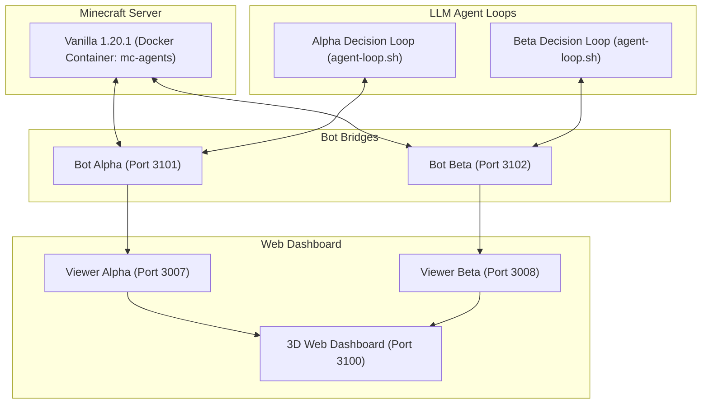

# Minecraft Autonomous Multi-Agent AI (Alpha & Beta) 🤖⛏️

[](https://www.minecraft.net/)
[](https://nodejs.org/)
[](https://www.docker.com/)
[](LICENSE)

An open-source experimental framework for **fully autonomous, cooperative multi-agent AI** in vanilla Minecraft. Two autonomous agents (**Alpha** and **Beta**) collaborate in survival mode without human intervention: gathering resources, crafting tools, building shelters, managing hunger and inventory, sleeping synchronously through nights, mining deep underground, and rescuing each other from hazards.

---

## 🌟 Key Features

* **Dual-Agent Cooperative Loop:**
  * **Role Specialization:** Emergent division of labor (Alpha: builder/smelter/logistics anchor; Beta: deep-slate miner/spelunker/nether pioneer).
  * **Shared Chest Logistics:** Agents exchange resources, food, and emergency recovery equipment through automated base storage.
  * **Inter-Agent Chat & Coordination:** Agents communicate via Minecraft chat to coordinate mining coordinates, sleep schedules, and door access.
* **Autonomous Survival Skills (`bridge/lib/skills.js`):**
  * Auto-crafting (furnaces, tables, wooden/stone/iron tools, full armor sets).
  * Auto-smelting with multiple furnaces and automatic fuel replenishment.
  * Pathfinder with hazard avoidance (lava, falls, drowning).
  * Synchronized sleep in beds when `timeOfDay >= 12542` to skip nights and prevent phantom spawns.
  * Emergency rescue protocols (crafting replacement gear and opening shelter doors after deaths).
* **Live 3D Web Dashboard & Spectator:**
  * Real-time 3D voxel terrain viewer built on Three.js.
  * Full modern world height support ($-64 \dots 320$).
  * Dual-mode camera: Top-down bird's-eye view (`🎥`) and immersive First-Person View (`👁`) with hotkey `V`.
* **Zero-Touch World State Management:**
  * Fast snapshots and rollbacks with `./save.sh <name>` and `./load.sh <name>`.

---

## 📊 Completed In-Game Milestones

| Milestone | Objective | Status | Key Output |
| :--- | :--- | :---: | :--- |
| **M1** | Build fortified shelter at spawn | **100%** | Cobblestone walls, roof, door, chests, furnaces, torches |
| **M2** | Iron tools & shields | **100%** | Iron pickaxes, axes, swords, and shields for both agents |
| **M3** | Full iron armor | **100%** | Helmets, chestplates, leggings, boots equipped on both agents |
| **M4** | Synchronized beds & spawnpoint | **100%** | Clean night skipping via dual beds in base |
| **M5** | Water buckets & food security | **100%** | Water buckets crafted, livestock hunted and cooked |
| **M6** | Diamond mining & diamond pickaxe | **100%** | 5 diamonds mined at $Y=-38$; `diamond_pickaxe` crafted |
| **M7** | Nether portal construction | **85%** | 8/10 obsidian mined with water bucket casting; flint & steel ready |

---

## 🏗️ Architecture



---

## 🚀 Quick Start Guide

### Prerequisites
* **Linux** (tested on Ubuntu 22.04 / 24.04)
* **Docker & Docker Compose** (for the vanilla Minecraft server)
* **Node.js 18+** & **npm**
* **Antigravity (`agy`)** or an LLM API CLI of your choice

### 1. Installation
Clone the repository and install bridge dependencies:
```bash
git clone https://github.com/cyberdid/minecraft-ai-agents.git
cd minecraft-ai-agents
(cd bridge && npm install)
```

### 2. Start the Minecraft Server
```bash
./start.sh
```
This launches the containerized Minecraft server on `127.0.0.1:25565` and starts the Mineflayer bot bridges.

### 3. Open the 3D Live Dashboard
In your browser, navigate to:
```
http://localhost:3100
```
* Use mouse to rotate, pan, and zoom.
* Click **👁 Від 1-ї особи** or press **`V`** to switch between overhead spectator and first-person perspective.

### 4. Run the Autonomous Agents
In two separate terminals, start the decision loops:
```bash
# Terminal 1: Alpha
./agent-loop.sh alpha

# Terminal 2: Beta
./agent-loop.sh beta
```

### 5. Managing World State
```bash
# Save a snapshot of the current world:
./save.sh my-checkpoint

# List available saves:
./save.sh

# Restore a saved snapshot:
./load.sh my-checkpoint

# Clean shutdown of all bots, loops, and server:
./stop.sh --all
```

---

## 📜 Repository Structure

```
├── agent-loop.sh       # Main autonomous turn loop
├── agent.sh            # Single agent execution wrapper
├── agents/             # Agent system prompts and configurations
│   ├── alpha/          # Prompts and skills definition for Alpha
│   └── beta/           # Prompts and skills definition for Beta
├── bridge/             # Mineflayer bot bridge & 3D WebGL viewer
│   ├── bot.js          # Bot connection and action execution server
│   ├── dashboard.js    # Multi-bot web interface server
│   ├── viewer.js       # Prismarine 3D voxel chunk streamer
│   ├── lib/skills.js   # High-level macro skills (crafting, mining, storage)
│   └── public/         # Frontend WebGL viewer assets
├── logs/               # Detailed execution traces (chat, programs, events)
├── server/             # Docker Compose setup & world storage
│   ├── docker-compose.yml
│   ├── data/world/     # Active world data and player stats
│   └── saves/          # Milestone checkpoint saves
└── docs/               # Analytical reports and specifications
```

---

## 📄 License
This project is licensed under the [MIT License](LICENSE).
